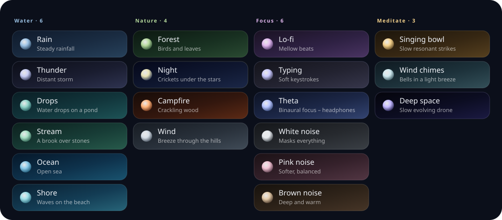
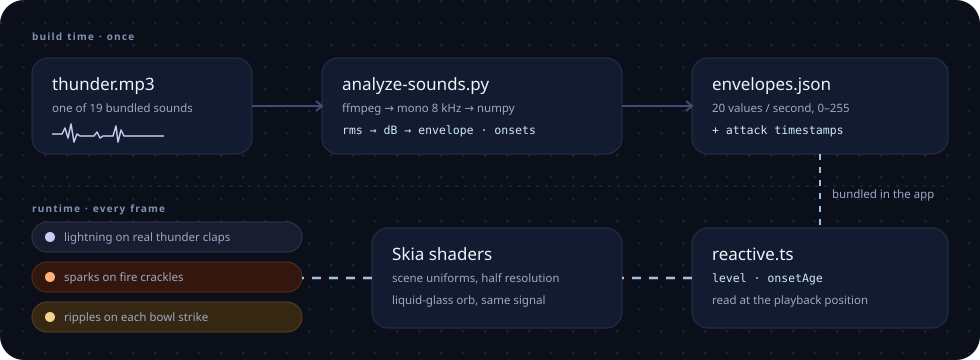

<div align="center">



<br />
<br />

**calm soundscapes and living scenes, fully offline.**<br />
<sub><i>irery</i> means <i>alone</i> in Malagasy: your own quiet bubble.</sub>

<br />
<br />

[](https://expo.dev)
[](https://reactnative.dev)
[](https://shopify.github.io/react-native-skia/)
[](#-run-it)
[](#-private-by-construction)
[](#-private-by-construction)
[](#-the-sounds)

<br />

```bash
npm install && npx expo start
```

<br />

### 19 soundscapes · 9 GPU scenes · 0 network requests

No account. No backend. No AI. No video files, no images.<br />
Every sound ships inside the app, and every scene is drawn live by a shader that listens to it.

</div>

---

<div align="center">

## 🫧 What Irery is

</div>

Pick a sound and the screen becomes a place: rain sliding down a window, a moonlit sea, a campfire throwing sparks, a starry night with the Milky Way. The scene isn't a loop playing next to the audio. It **follows the recording**: lightning strikes on the actual thunder claps, ripples open when the singing bowl is struck, the waves swell with the surf.

In the middle sits a **liquid-glass orb**. It breathes at the mood's pace, swirls with the sound, sends a ring out on every attack, and it's the play button.

Then the controls fade away, and it's just you and the place.

<table align="center">
  <tr>
    <td align="center" width="33%"><b>🌧️ Living scenes</b><br /><sub>drawn every frame by Skia shaders,<br />no video, no images</sub></td>
    <td align="center" width="33%"><b>🎧 Sound-reactive</b><br /><sub>visuals read the real recording,<br />with no microphone permission</sub></td>
    <td align="center" width="33%"><b>✈️ Fully offline</b><br /><sub>every sound, font and runtime is bundled,<br />even for the web preview</sub></td>
  </tr>
  <tr>
    <td align="center"><b>🔮 Liquid-glass orb</b><br /><sub>breathes, swirls and rings with the sound,<br />and doubles as play / pause</sub></td>
    <td align="center"><b>🌙 Sleep timer</b><br /><sub>15 to 90 minutes, with a gentle<br />30-second fade at the end</sub></td>
    <td align="center"><b>🔊 Equal loudness</b><br /><sub>every sound normalised to −23 LUFS,<br />so switching never jumps</sub></td>
  </tr>
</table>

---

<div align="center">

## 🎚️ The soundscapes

Nineteen sounds in four moods. Each one carries its own colours, scene and breathing pace.

</div>



<details>
<summary><b>Which scene plays with which sound</b></summary>

<br />

| Mood | Sound | Scene (shader) | Signature moment |
| :-- | :-- | :-- | :-- |
| Water | Rain | `RAIN_GLASS` · drops sliding down a window |  |
| Water | Thunder | `RAIN_GLASS` + storm | **lightning on real thunder claps** |
| Water | Drops | `POND` · a rippling pond |  |
| Water | Stream | `STREAM` · a brook with caustics |  |
| Water | Ocean | `SEA` · a moonlit sea | **waves and foam swell with the surf** |
| Water | Shore | `SEA` | **waves and foam swell with the surf** |
| Nature | Forest | `FOREST` · mist and light shafts |  |
| Nature | Night | `NIGHT` · stars, Milky Way, aurora |  |
| Nature | Campfire | `FIRE` · flames and embers | **sparks fly on crackles** |
| Nature | Wind | `CLOUDS` · drifting clouds |  |
| Focus | Lo-fi | `RAIN_GLASS` |  |
| Focus | Typing | `RAIN_GLASS` |  |
| Focus | Theta | `POND` |  |
| Focus | White noise | `MIST` |  |
| Focus | Pink noise | `NIGHT` |  |
| Focus | Brown noise | `MIST` |  |
| Meditate | Singing bowl | `POND` | **a ripple opens on each strike** |
| Meditate | Wind chimes | `CLOUDS` |  |
| Meditate | Deep space | `NIGHT` |  |

Every scene also breathes with the sound's loudness; the signature moments are the ones tied to a sound's attacks.

</details>

---

<div align="center">

## 🎧 From sound to scene

The visuals listen to the sound without ever opening the microphone.

</div>



Listening live would need a microphone permission, and that's not something a calm app should ask for. So the listening happens **once, at build time**:

1. `scripts/analyze-sounds.py` decodes every recording with ffmpeg (mono, 8 kHz) and measures its loudness 20 times a second.
2. It also marks the **onsets**: the moments the sound suddenly gets louder, like a clap, a crackle or a strike.
3. Both are packed into `src/audio/envelopes.json` and ship with the app.
4. At runtime, `src/audio/reactive.ts` reads the envelope at the player's current position and exposes two values: `level` (smoothed loudness, 0 to 1) and `onsetAge` (seconds since the last attack).
5. The scene shader and the orb both take those as uniforms, so they move with exactly what you hear.

<table align="center">
  <tr>
    <td align="center"><b>Signal</b></td>
    <td align="center"><b>What it is</b></td>
    <td align="center"><b>What it drives</b></td>
  </tr>
  <tr>
    <td align="center"><code>level</code></td>
    <td align="center">smoothed loudness at the playback position</td>
    <td align="center">wave height, flame width, aurora and glow, the orb's swirl</td>
  </tr>
  <tr>
    <td align="center"><code>onsetAge</code></td>
    <td align="center">seconds since the most recent attack</td>
    <td align="center">lightning, sparks, ripples, the orb's ring</td>
  </tr>
  <tr>
    <td align="center"><code>breath</code></td>
    <td align="center">seconds per breath, set per mood</td>
    <td align="center">the orb's slow pulse (calmer moods breathe slower)</td>
  </tr>
</table>

---

<div align="center">

## ✋ Using it

Most of Irery is touch and swipe. The interface gets out of the way on its own.

</div>

<table align="center">
  <tr>
    <td align="center"><b>Gesture</b></td>
    <td align="center"><b>What happens</b></td>
  </tr>
  <tr>
    <td align="center">tap the orb</td>
    <td align="center">play / pause, with a ring rippling out</td>
  </tr>
  <tr>
    <td align="center">swipe left or right on the scene</td>
    <td align="center">next or previous sound; the new scene spreads in from the side you swiped</td>
  </tr>
  <tr>
    <td align="center">swipe up, or tap <b>Scenes</b></td>
    <td align="center">the scene carousel: every scene as a living card, with parallax and mood chips</td>
  </tr>
  <tr>
    <td align="center">tap a card</td>
    <td align="center">it grows into the full-screen scene, cross-fading the audio</td>
  </tr>
  <tr>
    <td align="center">wait 12 seconds</td>
    <td align="center">the controls fade away; any touch brings them back</td>
  </tr>
</table>

Buttons sink under the finger and spring back with haptic feedback. Irery remembers your last sound and volume, keeps playing in the background (including on silent mode, with lock-screen info), and respects the system **reduce motion** setting.

---

<div align="center">

## ⚡ Smooth on purpose

</div>

<table align="center">
  <tr>
    <td align="center"><b>❌ The usual way</b></td>
    <td align="center"><b>✅ What Irery does</b></td>
  </tr>
  <tr>
    <td align="center">Background videos, megabytes per scene</td>
    <td align="center">Scenes are maths: nine shaders, drawn live, no video and no images</td>
  </tr>
  <tr>
    <td align="center">Full-resolution rendering drains the battery</td>
    <td align="center">Scenes are soft, so they render at <b>half resolution</b>: a quarter of the GPU work, invisible to the eye</td>
  </tr>
  <tr>
    <td align="center">The first switch to a new scene stutters while it compiles</td>
    <td align="center">Every shader is <b>precompiled behind the splash screen</b>, so switching never stalls</td>
  </tr>
  <tr>
    <td align="center">Switching sounds is a hard cut</td>
    <td align="center">The new scene <b>spreads out from where you touched</b>, in time with the audio cross-fade</td>
  </tr>
  <tr>
    <td align="center">Blur on every panel, dropped frames everywhere</td>
    <td align="center">Only the bottom bar uses a live blur (real on iOS and web, a tint on Android); the rest use tints</td>
  </tr>
  <tr>
    <td align="center">Visuals pulse on a timer, not the sound</td>
    <td align="center">Visuals follow the <b>recording's own envelope and attacks</b></td>
  </tr>
  <tr>
    <td align="center">Some sounds blast, others whisper</td>
    <td align="center">Every file is normalised to <b>−23 LUFS</b></td>
  </tr>
</table>

---

<div align="center">

## 🔒 Private by construction

</div>

Irery can't leak what it never touches. There's no account, no analytics, no backend and no network code at all, and the permissions are locked down in `app.json`:

| Permission | Status | Why |
| :-- | :-- | :-- |
| Microphone / `RECORD_AUDIO` | **blocked** | the visuals read pre-computed envelopes instead |
| Storage read / write | **blocked** | sounds are bundled; preferences live in AsyncStorage |
| `MODIFY_AUDIO_SETTINGS` | allowed | needed for playback and audio focus |
| iOS background mode `audio` | allowed | keeps the sound playing with the screen off |

Even the web preview stays offline: Skia's runtime is loaded from `public/canvaskit.wasm`, which `npm install` copies in locally instead of fetching it from a CDN.

---

<div align="center">

## 🚀 Run it

</div>

```bash
git clone https://github.com/fatratra-png/irery.git
cd irery
npm install
```

<table align="center">
  <tr>
    <td align="center"><b>Target</b></td>
    <td align="center"><b>Command</b></td>
  </tr>
  <tr>
    <td align="center">Dev server (Expo Go or web)</td>
    <td align="center"><code>npx expo start</code>, then press <code>w</code> for web</td>
  </tr>
  <tr>
    <td align="center">Web preview</td>
    <td align="center"><code>npm run web</code></td>
  </tr>
  <tr>
    <td align="center">Android native build</td>
    <td align="center"><code>npm run android</code></td>
  </tr>
  <tr>
    <td align="center">iOS native build</td>
    <td align="center"><code>npm run ios</code></td>
  </tr>
</table>

Requires **Expo SDK 58**. The `android/` and `ios/` folders aren't committed: they're generated on demand (Expo Continuous Native Generation) from `app.json`.

---

## 🎼 The sounds

Seven of the nineteen ambiences aren't recordings at all. `scripts/generate-sounds.py` **synthesises them from maths** (filtered noise, bell partials, LFOs), so they need no samples, no downloads and no licences:

> singing bowl · wind chimes · night crickets · deep space · theta binaural · pink noise · brown noise

The same script then runs ffmpeg's two-pass `loudnorm` on **every** sound to a target of −23 LUFS, which is why moving from brown noise to thunder never makes you reach for the volume.

To rebuild the sounds and their analysis (needs `numpy` and `ffmpeg`):

```bash
python3 scripts/generate-sounds.py   # synthesise + normalise loudness
python3 scripts/analyze-sounds.py    # envelopes and attacks for the visuals
```

Re-run `analyze-sounds.py` whenever you add or replace a file in `assets/sounds/`, or its scene won't react.

---

## ➕ Adding a soundscape

A new sound is a data change, not a code change:

1. Drop the file in `assets/sounds/` (mp3, loopable).
2. Run both scripts above, so it's normalised and analysed.
3. Add an entry to `SOUNDS` in `src/sounds.ts`: a title and hint, a category, an Ionicons icon, and a **mood**: three gradient colours, an accent, a breathing pace and a scene.

```ts
{
  id: 'rain', title: 'Rain', hint: 'Steady rainfall', category: 'Water', icon: 'rainy-outline',
  source: require('../assets/sounds/rain.mp3'),
  mood: {
    colors: ['#0f1a2b', '#1a2c42', '#27415b'],   // top → bottom, muted on purpose
    accent: '#9cc3e6',                           // orb, particles, active controls
    scene: { shader: 'RAIN_GLASS', params: { drops: 1 } },
    breath: 9,                                   // seconds per breath; slower = calmer
  },
},
```

The carousel, thumbnails, orb colours and transitions all pick it up from there.

---

## 🏗️ Architecture

```
irery/
├── App.tsx                 fonts, splash, shader prewarm, welcome → player
├── src/
│   ├── sounds.ts           the 19 soundscapes and their moods
│   ├── audio/
│   │   ├── player.ts       cross-fading player, sleep timer, background playback
│   │   ├── reactive.ts     reads envelopes at the playback position → level, onsetAge
│   │   └── envelopes.json  generated by scripts/analyze-sounds.py
│   ├── scenes/
│   │   ├── shaders.ts      the nine scene shaders (SkSL)
│   │   ├── engine.ts       compile, prewarm, uniforms, thumbnails, half-res rendering
│   │   └── ShaderScene.tsx the live scene and its reveal transition
│   ├── components/
│   │   ├── Orb.tsx         the liquid-glass orb shader
│   │   ├── SceneCarousel.tsx  living cards with parallax and mood chips
│   │   └── ui.tsx          springy, haptic controls and glass panels
│   └── screens/
│       ├── WelcomeScreen.tsx
│       └── PlayerScreen.tsx   immersive player, gestures, idle fade
├── scripts/
│   ├── generate-sounds.py  synthesis + loudness normalisation
│   └── analyze-sounds.py   envelopes and onsets
├── assets/sounds/          every sound, bundled
└── public/canvaskit.wasm   Skia's web runtime, copied locally on install
```

---

## 🤝 Contributing

New scenes, new sounds and smoother frames are all welcome.

1. Fork the repository.
2. Create a branch (`git checkout -b feat/aurora-scene`).
3. Check it on a real device, not only the web preview: shaders and blur behave differently on Android.
4. Open a pull request describing what changed and how it feels.

---

<div align="center">

## 🧰 Stack


<br />
<br />


<sub><i>irery</i>: alone, in Malagasy. put your headphones on.</sub>

</div>
